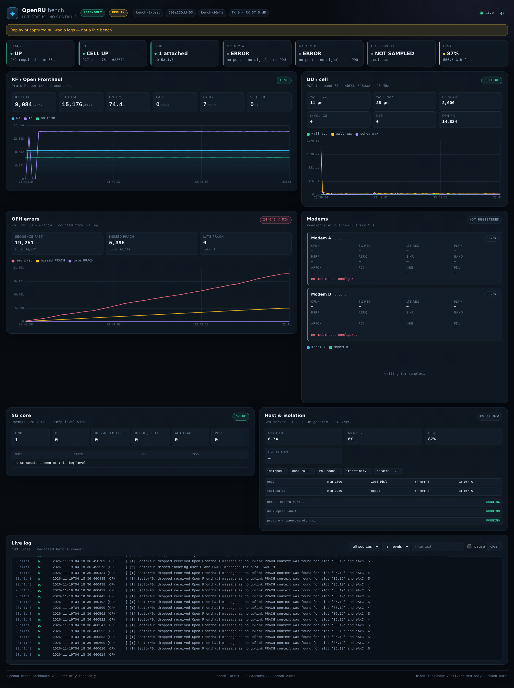
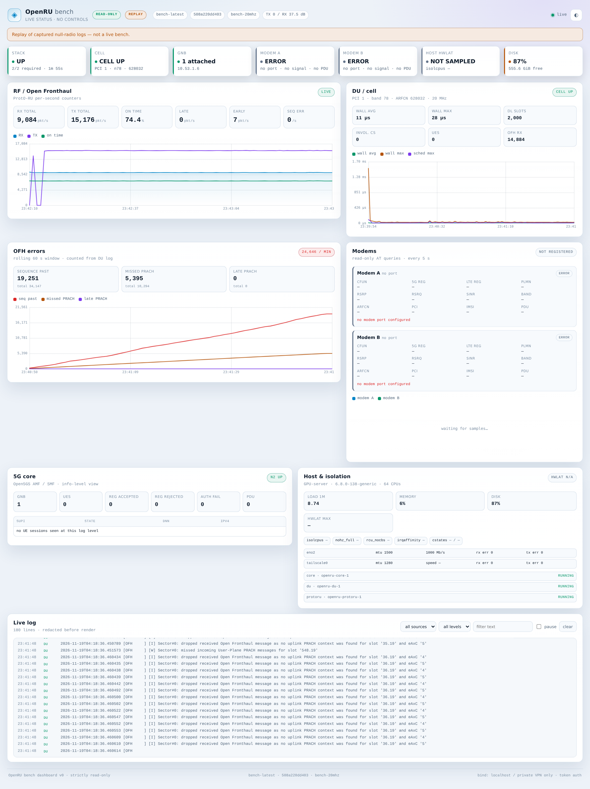

# OpenRU bench dashboard (read-only v0)

A small FastAPI + vanilla-JS dashboard for the live bench stack. It is strictly
observational: there are no buttons that change gain, restart containers, run
shell commands, or send modem `AT` set-commands.




The screenshots are a **REPLAY** of captured null-radio logs (the banner in the
UI says so). They are not a live measurement.

## What it shows

- **ProtO-RU** per-second RX/TX counters, on-time ratio, late/early/sequence
  errors from the `protoru` container log.
- **DU / cell** PCI, band, ARFCN, bandwidth, scheduler slots, wall/sched
  latency, OFH receive totals, and the cell-up state. The DU writes to
  `/tmp/gnb.log` inside the container, so the collector follows that file
  read-only with `tail -F` (the container's stdout is empty).
- **OFH errors** in a rolling 60 s window: eCPRI sequence-past messages, missed
  PRACH occasions, and late PRACH/UL grants (`nof_late_ul_req` deltas).
- **5G core** NG setup, gNB count, registration/auth/PDU counters and UE table
  from Open5GS AMF/SMF logs (info-level view).
- **Modems A/B** read-only `AT` polls (registration, signal, PLMN, PDU address)
  when serial ports are present. With no modem hardware the cards say
  `no modem port configured`.
- **Host / isolation** isolcpus, nohz_full, rcu_nocbs, cstate limits, cpusets,
  hwlat max, NIC counters, memory/disk, and the compose service list.

## Run it

```bash
make BENCH=1 dashboard
```

Then open `http://127.0.0.1:8787/` and enter the token printed on the console.
If `OPENRU_DASH_TOKEN` is not set, a one-time token is generated and printed.
The Makefile target never starts or builds containers; it only serves the
dashboard.

Useful overrides:

```bash
OPENRU_DASH_TOKEN='choose-a-long-token' make BENCH=1 dashboard
OPENRU_DASH_PORT=8788 make BENCH=1 dashboard
OPENRU_DASH_BIND=127.0.0.1 make BENCH=1 dashboard   # localhost only
OPENRU_MODEM_DISABLE=1 make BENCH=1 dashboard      # skip serial probing
```

Dependencies: `python3 -m pip install -r tools/dashboard/requirements.txt`.
The pinned FastAPI/Starlette pair matters; a much newer Starlette with an old
FastAPI fails with `Router.__init__() got an unexpected keyword argument
'on_startup'`.

### Bind safety

By default the app binds `127.0.0.1` and any private VPN-like interface
(`wg*`, `tun*`, `tap*`, `ppp*`, `zt*`, `nebula*`). It refuses
wildcard addresses (`0.0.0.0`, `::`) and public addresses. Use a private VPN or
an SSH tunnel; there is no TLS in v0. Raw VPN addresses and SSH targets are
redacted from the page, logs, and snapshots.

### Authentication

A single shared token, signed into an HttpOnly `SameSite=Lax` cookie, protects
every page and API endpoint. `OPENRU_DASH_ALLOW_ANON=1` disables auth for local
screenshots only; keep it on localhost and remove it afterwards.

## Null-radio dry run

The bench stack can be started without radios:

```bash
make BENCH=1 up STACK=e2e PROFILE=bench-20mhz UP_RADIO=null
```

Note: `make ... RADIO=null` is currently ignored by the Makefile; use
`UP_RADIO=null` as above. Do not run the bench stack while another session holds
the measurement lock.

## Replay mode (offline UI review / screenshots)

Replay mode loads a captured snapshot and starts **no collectors**. It is useful
while the bench is reserved or when a browser cannot reach the bench host.

```bash
python3 tools/dashboard/make_replay.py \
  --du docs/reports/runs/smoke-fh/evidence/20261118T025438Z-null/smoke-fh-du.log \
  --ru docs/reports/runs/smoke-fh/evidence/20261118T025438Z-null/smoke-fh-ru.log \
  --core /path/to/captured/core.log \
  --out /tmp/openru-replay.json

OPENRU_DASH_REPLAY=/tmp/openru-replay.json \
OPENRU_DASH_ALLOW_ANON=1 OPENRU_DASH_BIND=127.0.0.1 \
OPENRU_DASH_PORT=8787 python3 tools/dashboard/serve.py
```

The UI displays a `REPLAY` chip and banner. The committed screenshots were
generated this way from the null-radio dry-run captures; `make_replay.py` only
reads log files and never calls Docker. `--core` is optional; without real
registration logs the core card correctly shows `no UE sessions seen at this log
level`.

## Tests

```bash
make dashboard-test
# or
python3 -m unittest discover -s tools/dashboard/tests -v
```

Parser fixtures under `tests/fixtures/` use real ProtO-RU/DU lines and real
gNB/N2 lines captured on the bench. Modem `AT` responses and Open5GS
registration/auth/PDU lines are **format fixtures**, because this host has no
modem hardware and the captured core run did not include UE attach. They
exercise the parser formats without claiming those events happened live.

## Read-only design

- The browser only performs `GET /`, `GET /api/state`, `GET /api/events`
  (SSE), and static-file requests. The only `POST`s are `/login` and `/logout`.
- Docker is accessed through a minimal read-only API client (`GET` only) for
  `docker ps`-style state and log streaming.
- DU access is an exec of `tail -F -n 200 /tmp/gnb.log` (or `head -n 500` for
  the initial configuration seed) inside the container.
- Modem polling is an allow-list of query commands (`AT+CFUN?`, `AT+CSQ`,
  `AT+C5GREG?`, `AT+CEREG?`, `AT+CGPADDR`, `AT+CGDCONT?`, `AT+COPS?`,
  `AT+CIMI`, `AT+QNWINFO`, `AT+QENG="servingcell"`). No set-command is defined.
- No shell endpoint, no container restart, no gain control, no config writes.
- Secrets are redacted before they enter state: K/OPc/ADM-like 32-hex values,
  tokens/passwords/secrets, SSH targets, VPN addresses and VPN DNS names.
  IMSIs are masked in snapshots and log lines. The same patterns are
  checked by `make check-no-secrets`.

## Files

```
tools/dashboard/
  serve.py                 # starts collectors once, serves uvicorn binders
  make_replay.py           # capture -> replay JSON (no Docker)
  requirements.txt
  dashboard/app.py         # FastAPI routes, auth, CSP, SSE
  dashboard/config.py      # env/bench profile, safe binds, release info
  dashboard/state.py       # thread-safe state, redaction, replay loader
  dashboard/redact.py      # secret/IMSI redaction
  dashboard/collectors/    # Docker API, stack/host/DU/RU/core/modem threads
  dashboard/parsers/       # protoru, du, core, modem, host, stack parsers
  dashboard/static/        # index.html, app.js, style.css, login.html
  tests/                   # parser/redaction/replay unit tests
  screenshots/             # dark.png, light.png (REPLAY mode)
```

## Limits

- v0 has no controls; guarded v1 controls are out of scope.
- No TLS and no per-user accounts; use localhost or a private VPN and a long
  shared token.
- Open5GS debug-level messages (registration accept, auth request/response) are
  absent at the default info log level; the parser supports them but the UI
  will show zeros/requests until the core log level is raised.
- No modem hardware was available, so modem cards are unverified against real
  AT responses; the parser tests use documented-format fixtures.
- `docs/reports/raw/*` captures are gitignored in some checkouts; point
  `make_replay.py` at checked-in `docs/reports/runs/.../evidence/` logs or your
  own captures.
